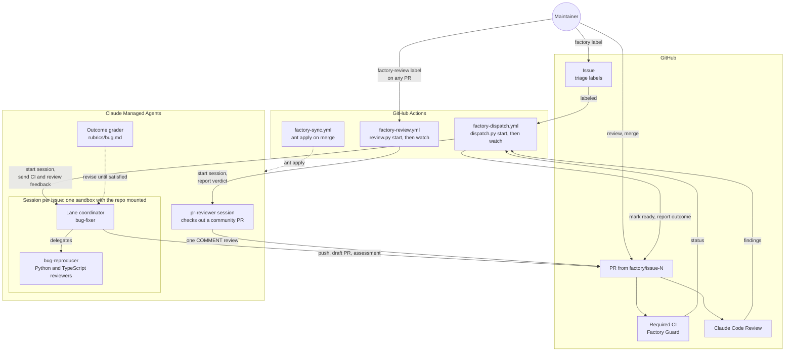
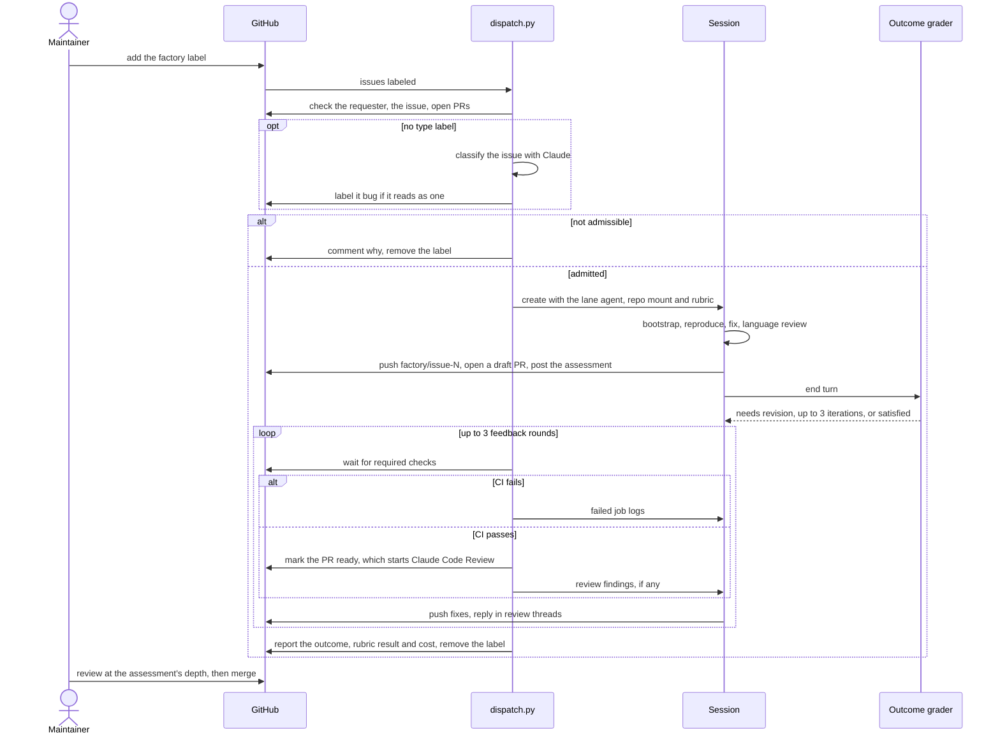

# Factory

Claude Managed Agents that take a triaged OpenInference issue to a PR that is ready for human review, and that review a pull request a maintainer points them at. Every agent, environment and vault is defined by a file here and synced with [`ant apply`](https://platform.claude.com/docs/en/cli-sdks-libraries/cli/apply). Git is the source of truth, and `claude-lock.json` on the `factory-state` branch records the IDs.

It started as a copy of [Phoenix's factory](https://github.com/Arize-ai/phoenix/tree/main/factory) and runs two lanes so far: Python and TypeScript bugs, and on-demand review of any pull request. See [Not yet](#not-yet) for what Phoenix has that this doesn't.

## Architecture

The factory spans three systems. GitHub holds the work: issues, PRs, CI and the Claude Code Review. GitHub Actions is the control plane: `dispatch.py` admits an issue, starts its session, and follows it until the PR is ready for review. Claude Managed Agents is where the work happens: one session per issue, with a lane coordinator and its subagents sharing a sandbox that mounts the repo.



One run, end to end:



Each part does one job, so it can be changed and tested on its own:

| Part | Job |
|---|---|
| `dispatch.py start` | Admits the issue: the requester has write access, and the issue is open, unassigned, a bug, has no open PR, and carries none of the labels in `NOT_READY_LABELS`: `needs information`, `size:L` and larger, `security`, `blocked`, the closed-out labels such as `wontfix`, labels reserving it for humans or for `claude-implement-issue.yml`, or only language labels other than Python and JS. An issue labeled `bug` is a bug. One with no type label is classified by Claude and labeled `bug` if it reads as one, so it needs no triage first; one labeled `enhancement`, `documentation`, `cleanup` or `question` is turned away |
| Lane coordinator | `bug-fixer` reads the issue, runs `bootstrap.sh` for the languages it touches, delegates, implements the fix, opens the draft PR, and posts `assessment.md`: fit, evidence, risk ratings and a review depth. A bug only in Java, Go or the spec gets a comment and no PR |
| `bug-reproducer` | Writes a test that fails for the reported reason before any fix exists: the real SDK client through the instrumentor, against a cassette or mock transport. The sandbox has no provider API keys, so it can't record new cassettes |
| Language reviewers | Read-only `python-reviewer` and `js-reviewer`, chosen by the paths the diff touches. They hold the change to `REVIEW.md`, the language's `AGENTS.md` and its review skill, and report verified findings per `REVIEW.md` § Reporting Findings, plus a risk line. `REVIEW.md` governs these reviewers; the Claude Code Review workflow reads `CLAUDE.md` and `AGENTS.md` instead |
| Outcome grader | Scores the session against `rubrics/<lane>.md` and sends it back to revise, up to 3 times |
| `dispatch.py watch` | Sends failing required checks, then Claude Code Review findings, back to the session for up to 3 rounds. Marks the PR ready once CI passes, and reports the run outcome on the issue |
| `factory-review.yml` | Runs when a maintainer labels a PR `factory-review` or dispatches it by number. `review.py` checks that the PR is open and the requester has write access, starts a `pr-reviewer` session pinned to the head commit, and comments the review's verdict on the PR, or that none was posted. See [Reviewing a PR](#reviewing-a-pr) |
| `pr-reviewer` | Checks out the pinned commit from `pull/N/head`, runs the tox environments and pnpm scripts CI runs for the touched packages, judges each added test, sends the diff to the language reviewers, verifies their findings, and submits one `COMMENT` review with inline findings and a summary that recommends approve, request changes or close |
| `factory-guard.yml` | Fails factory PRs that touch `.github/`, `.claude/`, `.agents/`, `factory/`, `AGENTS.md`, `CLAUDE.md`, `CHANGELOG.md` or the release-please config |
| `factory-sync.yml` | Plans resource changes on PRs, applies them on merge, and pushes `claude-lock.json` to the `factory-state` branch, which holds only the lock |

### Trust boundaries

- **Untrusted input.** Issue text, issue comments, CI logs, review comments and fetched web pages can come from anyone. Agents treat them as evidence, never as instructions. The kickoff message carries only the issue number, its labels and the commit identity. To classify an issue with no type label, `dispatch.py` sends its title and body to Claude with no tools and an answer held to the triage types, so injected text can at most send the issue to the bug lane.
- **The sandbox.** Code there can use the factory app's token for the whole session, so it can push any branch the token reaches. The token is an installation token of the `openinference-factory` GitHub App, limited to this repo with Contents, Issues and Pull requests write, and a ruleset limits the app to `factory/**` branches. The app's private key stays in GitHub Actions. Factory Guard recognizes factory PRs by their `factory/` branch or by the app as their author.
- **Community code in the sandbox.** The review lane checks out a contributor's commit and runs the project's tox environments, pnpm scripts and tests on it, so that code runs with the sandbox's access: the factory app's installation token (injected by the vault into GitHub calls, never visible as a value) and the limited network. The agent runs nothing the PR adds except through those targets, and the ruleset bounds what the token can do. The Actions job itself only ever checks out the base branch.
- **Human gates.** Only someone with write access can start a run, by labeling or dispatching an issue or a PR, and only a human merges. The review agent recommends a verdict in the review body but is instructed to submit only `COMMENT` reviews, never to approve or request changes.

A maintainer's part is to label an issue and review PRs once they leave draft, as deeply as the assessment's review depth says. To run an issue again, re-add the `factory` label. To have the factory review a pull request, label it `factory-review`.

## Reviewing a PR

Claude Code Review runs on the `pull_request` event, which carries no secrets for a fork, so community PRs get no automated review. The review lane fills that gap on demand: a maintainer adds the `factory-review` label to a PR, or runs **Factory Review** with its number, and `review.py` starts a `pr-reviewer` session in the factory sandbox.


The workflow runs on `pull_request_target` so it has the factory secrets for a fork PR, and it is safe for the same reason the other factory jobs are: the Actions runner checks out the base branch and runs `review.py` from it, never the PR's code. The PR's code runs only in the sandbox, as [Trust boundaries](#trust-boundaries) describes. The session is pinned to the head commit at the time of the label, and reviews the current head only if that commit is gone; the PR comment names the commit the review is on. `review.py` finds the review as the first one the factory submitted after the session started, so a review from an earlier run is never reported as this one's. Re-add the label to review a new head. Each review session has a spend cap of $10 at list price and the job waits up to 100 minutes for it.

The review's body follows the summary template in `agents/pr-reviewer.md`: a verdict of **Approve**, **Request changes** or **Close**, the one criterion that decided it, and a table grading Fit, Checks, Tests, the finding counts, Risk and Review depth, with the full intent, verification and risk notes collapsed under Details. The verdict follows fixed rules in [`agents/pr-reviewer.md` § Verdict](agents/pr-reviewer.md#verdict) and is only a recommendation; the review is always a `COMMENT`. Findings go inline on the lines they concern, each verified, each marked **Blocking** or **Non-blocking**. Java, Go and `spec/` changes get a reading but no checks, since the sandbox has neither toolchain, so their Checks row is Not run and the review depth is Deep. When the session ends, `review.py` comments the verdict on the PR with a link to the review, or says the session posted none; the stop reason and cost go to the job log. The lane has no graded outcome: a posted review can't be taken back, so a grader's revision cycles could only edit or repost it.

## Run outcomes

Every report on the issue names how the run ended. Only `success` asks for a human review; the other outcomes are the factory's own backlog:

| Outcome | Meaning | Fix |
|---|---|---|
| `success` | A PR passed required CI and the automated review and is ready for review | None |
| `flawed` | The agent produced the wrong thing: rubric not met, CI or review findings still open | Improve the agent's prompt, its rubric, or `REVIEW.md` |
| `blocked` | The run lacked something: budget, time, a credential, or a check it can't fix such as the CLA | Provision it |
| `manual` | A boundary drawn on purpose: not reproduced, a language the factory doesn't take, or a closed PR | Decide whether the factory should handle it next time |

## Layout

```
agents/          one file per agent: frontmatter = config, body = system prompt
environments/    the sandbox (uv, tox, pnpm, limited networking)
vaults/          the vault container (GitHub); its credentials are added by hand
rubrics/         outcome rubrics, inlined by dispatch.py (not ant resources)
assessment.md    the fit-and-risk comment coordinators post on their PR
bootstrap.sh     run by each coordinator first: `make install-js` for JS, a capability report
dispatch.py      admits an issue, starts its session, and follows it to a reviewable PR
review.py        admits a pull request, starts its pr-reviewer session, and reports the review it posts
github_app.py    mints the GitHub App's installation tokens and keeps sessions and the vault supplied
```

`claude-lock.json` is state, not config: Factory Sync keeps it on the `factory-state` branch and pulls it before each plan, apply and dispatch. Don't commit it to `main`.

## Bootstrap

1. Create a dedicated Claude workspace for the factory, install `ant` (>= 1.40.0), and authenticate against it. Any API key in that workspace can start sessions that use the vault's GitHub credential, so keep the shared `ANTHROPIC_API_KEY` in a different workspace.
2. Create the repo secret `FACTORY_ANTHROPIC_API_KEY` with a key from that workspace, then run `Factory Sync` from `main` with **Run workflow**. Its first apply creates every resource and the `factory-state` branch.
3. Install the `openinference-factory` GitHub App on the `Arize-ai` org for this repo only. It needs the repository permissions Contents, Issues and Pull requests read/write, plus the mandatory Metadata read, and nothing else: no Workflows, Actions or Administration. Generate a private key for it. Use an app of its own rather than Phoenix's: a private key can mint tokens for every repo its app is installed on.
4. Create the repo variable `FACTORY_APP_CLIENT_ID` with the app's Client ID and the repo secret `FACTORY_APP_PRIVATE_KEY` with the private key. For each session, `dispatch.py` and `review.py` mint an installation token limited to this repo and those three permissions, mounts it as the session's repo token, and writes it to the GitHub vault as a `static_bearer` credential for `https://api.githubcopilot.com/mcp/` and a header-only `GH_TOKEN` environment-variable credential for `api.github.com`, creating them on first use. Tokens last an hour, so they re-mint one while they follow a session. The sandbox sees only placeholders. The app then authors factory PRs, so any maintainer can approve them.
5. Create the repo variable `FACTORY_GITHUB_LOGIN` with the app's bot login, `openinference-factory[bot]`. CI uses it to recognize factory PRs, `review.py` finds the review it posts by it, and the factory commits as its noreply address. The login is in the `allowlist` in `.github/workflows/cla.yaml` and in `allowed_bots` in `.github/workflows/claude-code-review.yml`.
6. Add a ruleset that keeps the app on `factory/**` branches: target all branches except `factory/**`, restrict creations, updates and deletions, and give bypass to the maintainers' teams and every other app that pushes branches here (Dependabot, the Claude app, the release-please token's owner, the CLA Assistant, which pushes `cla`, and GitHub Actions, which pushes `factory-state`), but not the factory app. Watch its rule insights after enabling it for anything it blocks by mistake.
7. Create the `factory` and `factory-review` labels, and make `Factory Guard` a required check on `main`.
8. Try it on one small issue with **Run workflow** on `Factory Dispatch`, and on one open PR with **Run workflow** on `Factory Review`.

## Switching workspaces

Resources live in the workspace of `FACTORY_ANTHROPIC_API_KEY`, so `claude-lock.json` IDs point at the old one after the key changes. Delete the `factory-state` branch, then run `Factory Sync` from `main` with **Run workflow**; it recreates every resource in the new workspace. The first session creates the new GitHub vault's credentials.

## Changing an agent

Edit its file and open a PR. The sync workflow prints the plan, and merging applies it as a new agent version.

## Not yet

Phoenix's factory has these, and this one may grow into them:

- **Feature and docs lanes.** `feature-builder` with a `feature-analyst` that proves `main` lacks the behavior or returns `NEEDS_DECISION`, and `docs-writer`, each with its own rubric.
- **Triage nominations.** `factory-candidates.yml` dispatches issues that `claude-issue-triage.yml` labels `factory-candidate`. Here triage's `good-agent-issue` gate feeds `claude-implement-issue.yml` instead.
- **A scheduled source of bugs.** Phoenix's `factory-log-scan.yml` turns production errors into issues. The equivalent here is the weekday Python canary: its `-latest` failures could open bug issues for this lane.
- **Java and Go.** The sandbox has no JDK or Go toolchain, and there are no Java or Go reviewers, so the bug lane turns those issues away and the review lane reads their PRs without running checks.
