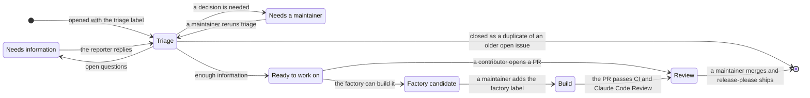
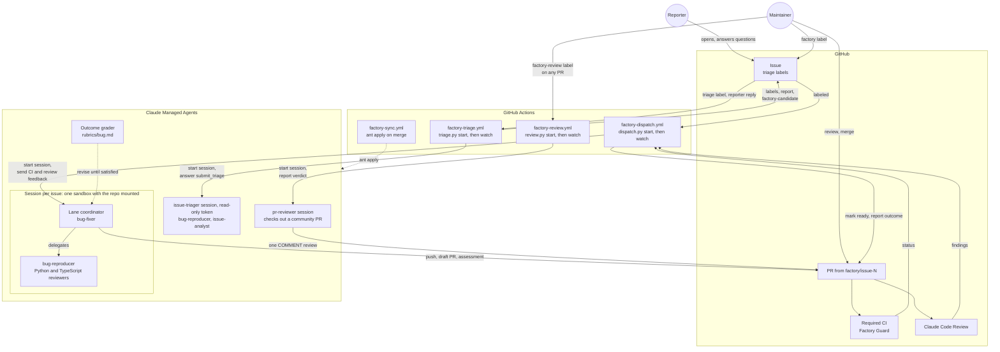
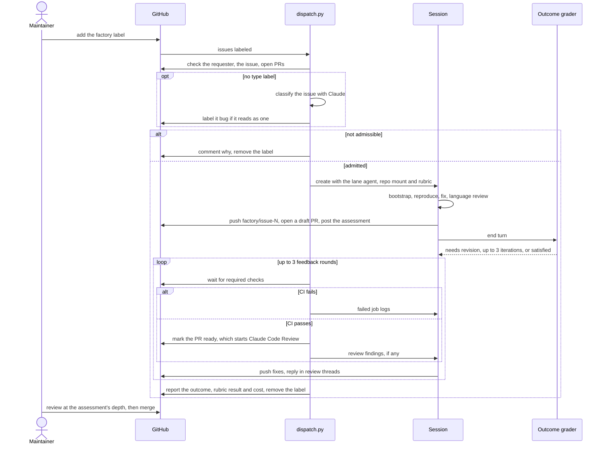
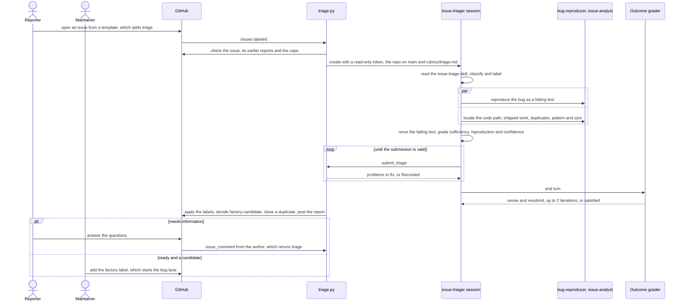
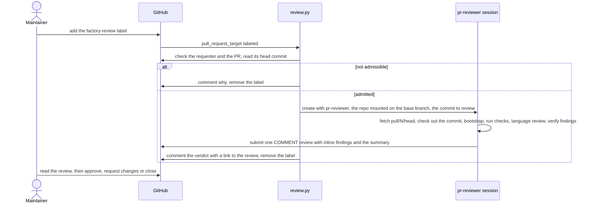

# Factory

Claude Managed Agents that triage a new OpenInference issue as soon as it is opened, take a triaged issue to a PR that is ready for human review, and review a pull request a maintainer points them at. Every agent, environment and vault is defined by a file here and synced with [`ant apply`](https://platform.claude.com/docs/en/cli-sdks-libraries/cli/apply). Git is the source of truth, and `claude-lock.json` on the `factory-state` branch records the IDs.

It started as a copy of [Phoenix's factory](https://github.com/Arize-ai/phoenix/tree/main/factory) and runs three lanes so far: triage of new issues, Python and TypeScript bugs, and on-demand review of any pull request. See [Not yet](#not-yet) for what Phoenix has that this doesn't.

## The issue lifecycle

An issue moves from report to release through six stages. At every stage its labels say whose move it is, so nothing waits on someone who doesn't know it's their turn. The factory automates triage, building and reviewing. Humans keep the two gates that spend money or ship code: starting a build and merging.



| Stage | Whose move | Marked by | What runs |
|---|---|---|---|
| Intake | Reporter | `triage`, which the issue templates add | |
| Triage | Factory | a `## Factory triage` report | `factory-triage.yml`: an `issue-triager` session reproduces the issue with subagents and grades whether there is enough information. See [Triaging an issue](#triaging-an-issue) |
| Needs information | Reporter | `needs information`, and the report's numbered questions addressed to them | The reporter's reply reruns triage, up to three sessions per issue |
| Needs a maintainer | Maintainer | the report's decisions; `triage` stays, so the weekday digest lists it | Nothing until a maintainer decides, then reruns triage or closes the issue |
| Duplicate | Nobody | closed as a duplicate, with `duplicate` | The report links the older issue it duplicates; a maintainer reopens it if the reporter shows it is different |
| Ready | Builder | type, language, package and size labels; `factory-candidate` when the factory can build it | `claude-issue-triage.yml` gates the ready issues that aren't factory candidates for people, such as `good first issue` |
| Build | Factory | `factory` | `factory-dispatch.yml`: the bug lane reproduces, fixes, reviews and opens a draft PR, then follows it through CI and Claude Code Review |
| Review | Maintainer | the PR leaves draft, with an assessment of its review depth | `factory-review.yml` reviews a community PR on request |
| Release | release-please | the merge | The release PR publishes to PyPI and npm |

Triage turns a report into one of four verdicts. Three hand the issue to whoever moves next, and the fourth closes it:

- **Needs information:** the reporter is asked numbered questions, each naming one missing fact and why it matters, and gets `needs information`. Their reply reruns triage, which removes the label once the questions are answered.
- **Needs a maintainer:** a decision only a maintainer can make, such as an attribute name the conventions don't settle, a change to `spec/`, a possible duplicate triage couldn't settle, or an already-shipped issue to close.
- **Ready to work on:** all three of the triage skill's sufficiency questions are answered (what happens now, what should happen, where to start) and nothing is left to decide. A ready issue is also a `factory-candidate` when the sandbox confirmed it with a failing test or probe, confidence is high, it is `size:S` or `size:M` in Python or TypeScript, and a fix needs no live provider recording. Those are the bug lane's own admission rules, so a candidate is an issue the factory would admit.
- **Duplicate:** an older issue that is still open reports the same behavior in the same package, so one fix closes both. Triage closes the new issue as its duplicate and points the reporter to it, so the discussion and the fix stay in one place.

The two triage paths split the backlog instead of competing for it. `claude-issue-triage.yml` sweeps the backlog every two days with the same `issue-triage` skill and gates issues for people. The factory triages each new issue the moment it arrives, reproduces it, talks to its reporter, and nominates issues for itself. The sweep never gates an issue carrying `factory-candidate`, and the factory never nominates one carrying a person's gate label.

## Architecture

The factory spans three systems. GitHub holds the work: issues, PRs, CI and the Claude Code Review. GitHub Actions is the control plane: `triage.py` triages a new issue, and `dispatch.py` admits an issue, starts its session, and follows it until the PR is ready for review. Claude Managed Agents is where the work happens: one session per issue, with a lane coordinator and its subagents sharing a sandbox that mounts the repo.



One run, end to end:



Each part does one job, so it can be changed and tested on its own:

| Part | Job |
|---|---|
| `factory-triage.yml` | Runs when an issue gets the `triage` label, which the issue templates add as it is opened, when its author replies to a `needs information` issue, or when a maintainer dispatches it by number. `triage.py start` skips a closed issue, one carrying `factory` or `agent-in-progress`, and a reply the latest report already covers. For requesters without write access it also caps triage at three sessions per issue in 90 days, failed ones included, and 20 sessions a day. Jobs for a burst of issues all pass that count together, so once a session exists `start` counts the sessions created before it, and archives it before its kickoff when it falls past the daily cap. See [Triaging an issue](#triaging-an-issue) |
| `issue-triager` | Classifies the issue by stages 1 to 5 of the `issue-triage` skill, sends the reproducer and the analyst out in parallel, reruns what they report, grades sufficiency, reproduction and confidence, writes the open questions, and calls `submit_triage`. Its GitHub token is read-only |
| `issue-analyst` | Read-only for the triager: locates the code path, checks for shipped work, duplicates and open PRs, names the pattern to follow and the decisions left open, says whether a fix needs a live recording, sizes the work, and for an enhancement runs a probe showing `main` lacks the behavior |
| `triage.py watch` | Answers each `submit_triage` call, checking it against the repo's labels and the grading rules and sending back what is wrong. Once the session ends, it labels the issue, decides `factory-candidate`, and posts the report as the app |
| `dispatch.py start` | Admits the issue: the requester has write access, and the issue is open, unassigned, a bug, has no open PR, and carries none of the labels in `NOT_READY_LABELS`: `needs information`, `size:L` and larger, `security`, `blocked`, the closed-out labels such as `wontfix`, labels reserving it for humans or for `claude-implement-issue.yml`, or only language labels other than Python and JS. An issue labeled `bug` is a bug. One with no type label is classified by Claude and labeled `bug` if it reads as one, so it needs no triage first; one labeled `enhancement`, `documentation`, `cleanup` or `question` is turned away |
| Lane coordinator | `bug-fixer` reads the issue, runs `bootstrap.sh` for the languages it touches, delegates, implements the fix, opens the draft PR, and posts `assessment.md`: fit, evidence, risk ratings and a review depth. A bug only in Java, Go or the spec gets a comment and no PR |
| `bug-reproducer` | Writes a test that fails for the reported reason before any fix exists: the real SDK client through the instrumentor, against a cassette or mock transport. The sandbox has no provider API keys, so it can't record new cassettes. The triage and bug lanes share it, so a bug triage calls reproduced is one the bug lane can reproduce |
| Language reviewers | Read-only `python-reviewer` and `js-reviewer`, chosen by the paths the diff touches. They hold the change to `REVIEW.md`, the language's `AGENTS.md` and its review skill, and report verified findings per `REVIEW.md` § Reporting Findings, plus a risk line. `REVIEW.md` governs these reviewers; the Claude Code Review workflow reads `CLAUDE.md` and `AGENTS.md` instead |
| Outcome grader | Scores the session against `rubrics/<lane>.md` and sends it back to revise, up to 3 times |
| `dispatch.py watch` | Sends failing required checks, then Claude Code Review findings, back to the session for up to 3 rounds. Marks the PR ready once CI passes, and reports the run outcome on the issue |
| `factory-review.yml` | Runs when a maintainer labels a PR `factory-review` or dispatches it by number. `review.py` checks that the PR is open and the requester has write access, starts a `pr-reviewer` session pinned to the head commit, and comments the review's verdict on the PR, or that none was posted. See [Reviewing a PR](#reviewing-a-pr) |
| `pr-reviewer` | Checks out the pinned commit from `pull/N/head`, runs the tox environments and pnpm scripts CI runs for the touched packages, judges each added test, sends the diff to the language reviewers, verifies their findings, and submits one `COMMENT` review with inline findings and a summary that recommends approve, request changes or close |
| `factory-guard.yml` | Fails factory PRs that touch `.github/`, `.claude/`, `.agents/`, `factory/`, `AGENTS.md`, `CLAUDE.md`, `CHANGELOG.md` or the release-please config |
| `factory-sync.yml` | Plans resource changes on PRs, applies them on merge, and pushes `claude-lock.json` to the `factory-state` branch, which holds only the lock |

### Trust boundaries

- **Untrusted input.** Issue text, issue comments, CI logs, review comments and fetched web pages can come from anyone. Agents treat them as evidence, never as instructions. The kickoff message carries only the issue number, its labels and the commit identity. To classify an issue with no type label, `dispatch.py` sends its title and body to Claude with no tools and an answer held to the triage types, so injected text can at most send the issue to the bug lane.
- **Triage starts for anyone.** Opening an issue from a template or replying to a `needs information` report starts a triage session, so its sandbox gets less than the others: an installation token with Contents, Issues and Pull requests read only, written to its own vault (`vaults/github-readonly.yaml`), so it can't push, label or comment. The triager's only way out is `submit_triage`. `triage.py` checks the call against the repo's labels and the grading rules, decides the labels, the nomination and any duplicate close in code, and posts with a separate Issues-write token that no session sees. The only issue it can close is the one being triaged, and only as a duplicate of an older open issue. In the report it neutralizes mentions, raw HTML and link markup outside code, so injected text can't notify anyone, hide part of the report, or disguise a link in a comment the factory signs. The caps per issue and per day bound what a stream of issues can spend. `claude-lock.json` comes from `factory-state`, a branch the app's token can push from another lane's sandbox, so `triage.py` checks that the triager's agent and vault IDs name `openinference-issue-triager` and `factory-github-readonly` before it mints a token. Only the workspace's API key can rename them. A ruleset that lets only GitHub Actions push `factory-state` would close the branch itself.
- **The sandbox.** Code there can use the factory app's token for the whole session, so it can push any branch the token reaches. The token is an installation token of the `openinference-factory` GitHub App, limited to this repo with Contents, Issues and Pull requests write, and no ruleset limits its branches, because the app also authors the release and sync PRs (see [Bootstrap](#bootstrap)). A session can therefore push to a `release-please--*` or `changeset-release/*` branch, and merging that PR publishes packages, so read every commit on a release PR before merging it. The app's private key stays in GitHub Actions. Factory Guard recognizes factory PRs by their `factory/` branch or by the app as their author, except on the release-please, changesets and skills-update branches.
- **Community code in the sandbox.** The review lane checks out a contributor's commit and runs the project's tox environments, pnpm scripts and tests on it, so that code runs with the sandbox's access: the factory app's installation token (injected by the vault into GitHub calls, never visible as a value) and the limited network. The agent runs nothing the PR adds except through those targets, and the token's three permissions bound what it can do. The Actions job itself only ever checks out the base branch.
- **Human gates.** Only someone with write access can start a build or a review, by labeling or dispatching an issue or a PR, and only a human merges. Triage only nominates: `factory-candidate` starts nothing. The review agent recommends a verdict in the review body but is instructed to submit only `COMMENT` reviews, never to approve or request changes.

A maintainer's part is to answer what triage hands them, label an issue `factory`, and review PRs once they leave draft, as deeply as the assessment's review depth says. To triage an issue again, run **Factory Triage** with its number, or remove and re-add `triage`. To run an issue again, re-add the `factory` label. To have the factory review a pull request, label it `factory-review`.

## Triaging an issue

Triage decides whose move an issue is, and backs that with evidence from the sandbox rather than a reading of the text. It starts when an issue gets the `triage` label, which the bug and feature templates add as the issue is opened. It runs again when the issue's author replies while it carries `needs information`, and on demand with **Factory Triage** and an issue number.



The triager works the `issue-triage` skill's stages 1 to 5: the type, sufficiency, language, package and component labels, the instrumentor requirement labels, and the size with its raises. It skips the skill's body edits and person gates, which stay with the sweep. Then it investigates in parallel: `bug-reproducer` writes a failing test for a bug, and `issue-analyst` locates the code and, for an enhancement, probes `main` for the missing behavior. The triager reruns whatever they report as reproduced before trusting it. Java, Go and `spec/` issues get the analyst's reading only.

The submission grades three things, and `triage.py` holds the confidence to them so it means the same on every issue:

| Grade | Values | Rule |
|---|---|---|
| Sufficiency | `answered`, `partial` or `missing` for each of what happens now, what should happen, and where to start | Anything short of `answered` needs an open question for the reporter |
| Reproduction | `confirmed`, `not_confirmed` or `not_attempted` | `confirmed` means a test or probe the triager ran shows the problem, and it comes with the command and the test |
| Confidence | `high`, `medium` or `low` | `low` when a sufficiency question isn't answered or the reproduction is `not_confirmed`; `high` when the reproduction is `confirmed` and nothing is left to ask; `medium` otherwise |

`triage.py` then decides, in code, from the submission:

- **The verdict.** A duplicate that `triage.py` may close makes it *Duplicate*. Open questions make it *Needs information*. Maintainer questions, a duplicate it may not close, possible duplicates, fully shipped work, a `question` or an off-topic issue make it *Needs a maintainer*. Otherwise it is *Ready to work on*.
- **The close.** The triager names the issue this one duplicates in `duplicate_of` only when nothing is left to ask and it quotes both issues reporting the same behavior. `triage.py` checks that the other issue is an older issue on this repo that is still open, then checks it again after the session ends. It closes the issue as its duplicate only when the rubric was satisfied, and the issue is unassigned with no open PR. Otherwise the match goes to a maintainer, with the reason it stayed open. A closed or newer match always does, since a newer one is the issue to close and a closed one may mean a regression.
- **The labels.** It adds the triage families the submission names that exist on the repo, adds or removes `needs information` with the verdict, and adds `duplicate` when it closes the issue. It replaces a type label the template guessed wrong. It never removes anything else, so a maintainer's labels stay.
- **The nomination.** It adds `factory-candidate` to a ready bug or enhancement only when the reproduction is confirmed, confidence is high, the rubric was satisfied, no live recording is needed, and the issue passes the bug lane's admission: none of `NOT_READY_LABELS`, `size:S` or `size:M`, Python or TypeScript only, unassigned and with no open PR. An enhancement that touches `c/semcov` or adds an instrumentor waits for a maintainer's agreement. A rerun removes a nomination that no longer holds.

The report is one comment headed `## Factory triage: <verdict>`. A *Needs information* report addresses the author and numbers the questions, each with why it matters. A *Needs a maintainer* report lists the decisions. A *Duplicate* report links the older issue, quotes why it matches, and tells the reporter to add what that issue lacks there, or to reply here if the problem is different. Every report has a summary and a table of type, reproduction, confidence, label changes and the factory nomination, with the sufficiency grades, the reproduction command and test, the code to start from, and any shipped or duplicate evidence collapsed under Investigation. When the issue seems to hold a secret or personal data, the report opens with a warning naming its kind and place, never its value. The bug lane reads the latest report and starts its reproduction from that test.

Anyone can start triage, so its failures stay off the issue. When a run is skipped, ends without a valid submission, or finds the issue closed or taken by an agent, `triage.py` writes why to the job log. The issue keeps `triage`, so the weekday digest still lists it for a maintainer. The rubric result and the cost go to the job log too. Each triage session has a spend cap of $10 at list price, and the job waits up to 75 minutes for it.

## Reviewing a PR

Claude Code Review runs on the `pull_request` event, which carries no secrets for a fork, so community PRs get no automated review. The review lane fills that gap on demand: a maintainer adds the `factory-review` label to a PR, or runs **Factory Review** with its number, and `review.py` starts a `pr-reviewer` session in the factory sandbox.



The workflow runs on `pull_request_target` so it has the factory secrets for a fork PR, and it is safe for the same reason the other factory jobs are: the Actions runner checks out the base branch and runs `review.py` from it, never the PR's code. The PR's code runs only in the sandbox, as [Trust boundaries](#trust-boundaries) describes. The session is pinned to the head commit at the time of the label, and reviews the current head only if that commit is gone; the PR comment names the commit the review is on. `review.py` finds the review as the first one the factory submitted after the session started, so a review from an earlier run is never reported as this one's. Re-add the label to review a new head. Each review session has a spend cap of $10 at list price and the job waits up to 100 minutes for it.

The review's body follows the summary template in `agents/pr-reviewer.md`: a verdict of **Approve**, **Request changes** or **Close**, the one criterion that decided it, and a table grading Fit, Checks, Tests, the finding counts, Risk and Review depth, with the full intent, verification and risk notes collapsed under Details. The verdict follows fixed rules in [`agents/pr-reviewer.md` § Verdict](agents/pr-reviewer.md#verdict) and is only a recommendation; the review is always a `COMMENT`. Findings go inline on the lines they concern, each verified, each marked **Blocking** or **Non-blocking**. Java, Go and `spec/` changes get a reading but no checks, since the sandbox has neither toolchain, so their Checks row is Not run and the review depth is Deep. When the session ends, `review.py` comments the verdict on the PR with a link to the review, or says the session posted none; the stop reason and cost go to the job log. The lane has no graded outcome: a posted review can't be taken back, so a grader's revision cycles could only edit or repost it.

## Run outcomes

Every report the bug lane posts on an issue names how the run ended. Only `success` asks for a human review; the other outcomes are the factory's own backlog:

| Outcome | Meaning | Fix |
|---|---|---|
| `success` | A PR passed required CI and the automated review and is ready for review | None |
| `flawed` | The agent produced the wrong thing: rubric not met, CI or review findings still open | Improve the agent's prompt, its rubric, or `REVIEW.md` |
| `blocked` | The run lacked something: budget, time, a credential, or a check it can't fix such as the CLA | Provision it |
| `manual` | A boundary drawn on purpose: not reproduced, a language the factory doesn't take, or a closed PR | Decide whether the factory should handle it next time |

## Layout

```
agents/          one file per agent: frontmatter = config, body = system prompt
environments/    the sandbox (uv, tox, pnpm, limited networking)
vaults/          the vault containers: GitHub, and GitHub read-only for triage; the scripts write their credentials
rubrics/         outcome rubrics, inlined by dispatch.py and triage.py (not ant resources)
assessment.md    the fit-and-risk comment coordinators post on their PR
bootstrap.sh     run by each coordinator first: `make install-js` for JS, a capability report
triage.py        triages a new issue: starts its session, answers its submission, labels the issue and posts the report
dispatch.py      admits an issue, starts its session, and follows it to a reviewable PR
review.py        admits a pull request, starts its pr-reviewer session, and reports the review it posts
github_app.py    mints the GitHub App's installation tokens and keeps sessions and the vault supplied
```

`claude-lock.json` is state, not config: Factory Sync keeps it on the `factory-state` branch and pulls it before each plan, apply and dispatch. Don't commit it to `main`.

## Bootstrap

1. Create a dedicated Claude workspace for the factory, install `ant` (>= 1.40.0), and authenticate against it. Any API key in that workspace can start sessions that use the vault's GitHub credential, so keep the shared `ANTHROPIC_API_KEY` in a different workspace.
2. Create the repo secret `FACTORY_ANTHROPIC_API_KEY` with a key from that workspace, then run `Factory Sync` from `main` with **Run workflow**. Its first apply creates every resource and the `factory-state` branch.
3. Install the `openinference-factory` GitHub App on the `Arize-ai` org for this repo only. It needs the repository permissions Contents, Issues and Pull requests read/write, plus the mandatory Metadata read, and nothing else: no Workflows, Actions or Administration. Generate a private key for it. Use an app of its own rather than Phoenix's: a private key can mint tokens for every repo its app is installed on.
4. Create the repo variable `FACTORY_APP_CLIENT_ID` with the app's Client ID and the repo secret `FACTORY_APP_PRIVATE_KEY` with the private key. For each session, `dispatch.py` and `review.py` mint an installation token limited to this repo and those three permissions, mounts it as the session's repo token, and writes it to the GitHub vault as a `static_bearer` credential for `https://api.githubcopilot.com/mcp/` and a header-only `GH_TOKEN` environment-variable credential for `api.github.com`, creating them on first use. Tokens last an hour, so they re-mint one while they follow a session. The sandbox sees only placeholders. `triage.py` does the same with a read-only token and the read-only vault, and mints a separate Issues-write token, which no vault holds, to post its reports. The app then authors factory PRs, so any maintainer can approve them. The release and sync workflows (`release.yml`, `typescript-publish.yaml`, `bump-openinference-instrumentation-version.yml`, `bump-openinference-semantic-conventions-version.yml` and `skills-update.yml`) mint their own installation token from the same variable and secret with `actions/create-github-app-token`, so the app authors those PRs too.
5. Create the repo variable `FACTORY_GITHUB_LOGIN` with the app's bot login, `openinference-factory[bot]`. CI uses it to recognize factory PRs, `review.py` finds the review it posts by it, and the factory commits as its noreply address. The login is in the `allowlist` in `.github/workflows/cla.yaml` and in `allowed_bots` in `.github/workflows/claude-code-review.yml`.
6. Don't restrict the app's branches. It pushes the release-please, changesets, version-bump and sync branches as well as `factory/**`. If a ruleset from an earlier bootstrap keeps it on `factory/**`, delete the ruleset or add the app to its bypass list. Branch protection on `main` still applies to it, so its PRs need a maintainer's approval.
7. Create the `factory`, `factory-review` and `factory-candidate` labels, and make `Factory Guard` a required check on `main`. `triage.py` refuses to start until `factory-candidate`, `needs information` and `duplicate` exist.
8. Try it on one open issue with **Run workflow** on `Factory Triage`, on one small issue with **Run workflow** on `Factory Dispatch`, and on one open PR with **Run workflow** on `Factory Review`.

## Switching workspaces

Resources live in the workspace of `FACTORY_ANTHROPIC_API_KEY`, so `claude-lock.json` IDs point at the old one after the key changes. Delete the `factory-state` branch, then run `Factory Sync` from `main` with **Run workflow**; it recreates every resource in the new workspace. The first session creates the new GitHub vault's credentials.

## Changing an agent

Edit its file and open a PR. The sync workflow prints the plan, and merging applies it as a new agent version.

## Not yet

Phoenix's factory has these, and this one may grow into them:

- **Feature and docs lanes.** `feature-builder` with a `feature-analyst` that proves `main` lacks the behavior or returns `NEEDS_DECISION`, and `docs-writer`, each with its own rubric.
- **Building nominations unasked.** Phoenix's `factory-candidates.yml` dispatches `factory-candidate` issues whose author has write access. Here a maintainer adds `factory` to every candidate; `dispatch.py` already holds such a run to the issue author's access, so adopting it is a workflow away. An enhancement nominated now waits for a feature lane, since the bug lane turns enhancements away.
- **A scheduled source of bugs.** Phoenix's `factory-log-scan.yml` turns production errors into issues. The equivalent here is the weekday Python canary: its `-latest` failures could open bug issues for this lane.
- **Java and Go.** The sandbox has no JDK or Go toolchain, and there are no Java or Go reviewers, so the bug lane turns those issues away and the review lane reads their PRs without running checks.
